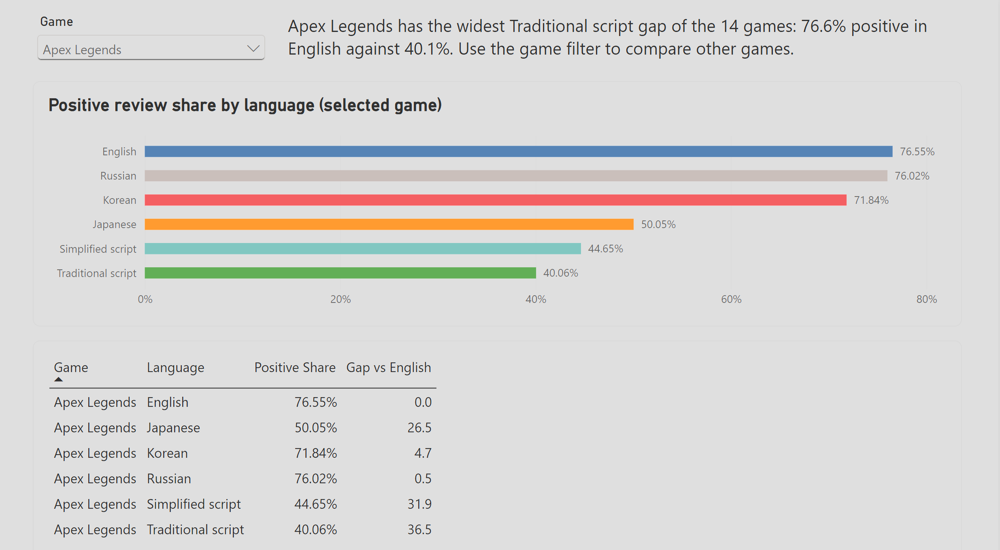
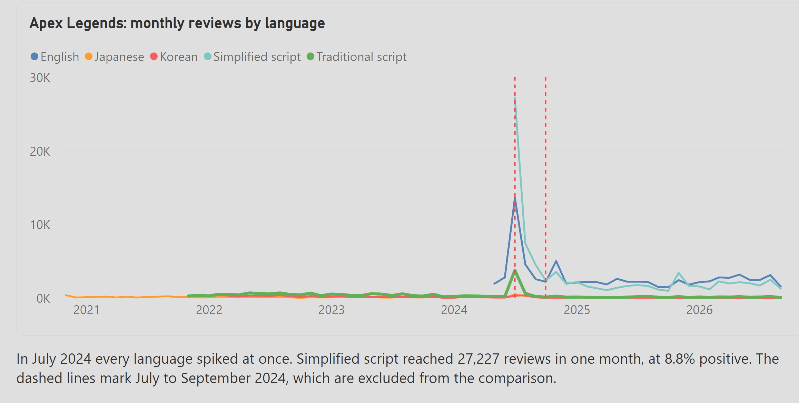
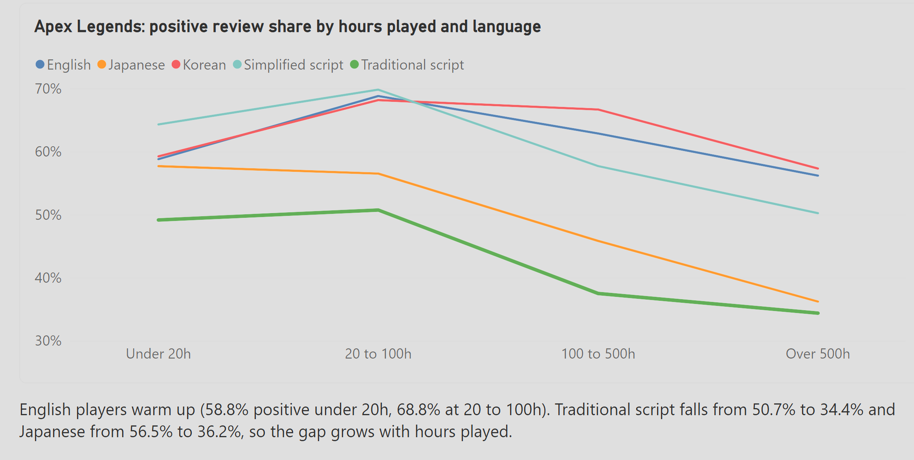
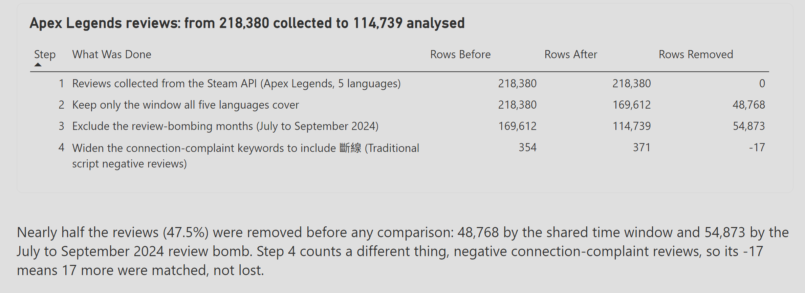

# Steam dashboards: the Apex Legends language gap

## The question

Players who write reviews in different languages rate the same game very differently. On Apex Legends, 76.6% of English reviews are positive, but only 40.1% of Traditional script reviews are, a gap of 36.5 points. Is that a quality problem, or something else? I answered this first in a written study (jozxo.github.io/player-sentiment). This project turns the same data into two dashboards, one in Tableau Public and one in Power BI Desktop, so anyone can look at it without reading code.

## The two data sources, and why each view uses which

1. **Apex Legends review file.** 218,380 reviews in 5 languages (English, Japanese, Korean, Simplified script, Traditional script), collected from the Steam API. It has a date and hours played for every review. So it feeds three views: data quality, monthly volume and hours played. It covers Apex Legends only.
2. **Steam lifetime summaries.** Positive and negative review counts per game and language for 14 games in 7 languages. These are summaries, with no dates and no hours. So it feeds the game and language view, which is the only view with a game filter. Apex English lifetime reviews: 450,786.

## Cleaning steps and data quality numbers

| Step | What was done | Rows before | Rows after |
|---|---|---|---|
| 1 | Reviews collected from the Steam API | 218,380 | 218,380 |
| 2 | Keep only the date window all five languages cover (2024-07-20 to 2026-09-21), because the collector reaches back a different distance in each language | 218,380 | 169,612 |
| 3 | Exclude the review-bombing months (July to September 2024) | 169,612 | 114,739 |
| 4 | Widen the connection-complaint keywords to include 斷線, a term the first list missed (counts matched reviews, not dropped rows) | 354 | 371 |

Nearly half the reviews (47.5%) were removed before any comparison: 48,768 by the shared window and 54,873 by the review bomb. The review bomb matters. In July 2024, Simplified script reached 27,227 reviews in one month at 8.8% positive, a protest that made one regional gap look bigger than it is. With those months included the Simplified script gap is 20.8 points. Without them it is 4.1.

The cleaned tables are in `dashboard_data/`. `build_tables.py` builds them from the raw review file, which is not in this repo (40 MB). The collection code is in the player-sentiment repo.

## Dashboard 1: Tableau Public

[Open the Tableau dashboard](https://public.tableau.com/app/profile/josiah/viz/ApexLegendslanguagegapSteamreviews/ApexLegendslanguagegap)

One vertical page with four views: data quality, monthly volume (with the review-bomb months shaded), positive share by game and language (with a game dropdown), and positive share by hours played. The workbook is in `tableau/`. The positive share is a calculated field I wrote: `SUM([Positive Reviews]) / SUM([Reviews])`.

## Dashboard 2: Power BI Desktop

Four pages, same story. Power BI's "Publish to web" needs a work or school account, so I exported the report instead.

- Report file: `powerBI/apex_language_gap.pbix`
- PDF of all four pages: `powerBI/apex_language_gap.pdf`

| | |
|---|---|
|  |  |
|  |  |

I wrote three DAX measures: Positive Share, Gap vs English (using CALCULATE and REMOVEFILTERS so the English figure stays fixed while the language changes), and Positive Share by hours played.

## What the dashboards show

- Apex Legends has the widest Traditional script gap of the 14 games: 76.6% positive in English against 40.1% (the next widest is Delta Force, 28.1).
- The gap grows with hours played. English players go from 58.8% positive under 20 hours to 68.8% at 20 to 100 hours. Traditional script falls from 50.7% to 34.4%.
- So the gap grows the longer people play.

## What I learned comparing Tableau and Power BI

- Tableau got me to a first chart faster, and Tableau Public gives you one public link. Power BI Desktop has no free public link, so I had to export a PDF and screenshots.
- Both need clean tables first. I spent most of the time on the data quality steps, not on either tool.
- The same calculation looks different in each: a Tableau calculated field works on whatever is in the view, while a Power BI DAX measure needs me to decide how filters apply. The Gap vs English measure was where that mattered.
- Power BI gave me finer control over layout and fonts, but it took many more rounds to make it look clean.

## Files

- `dashboard_data/`: the four cleaned tables
- `build_tables.py`: builds them from the raw data
- `tableau/`: the Tableau workbook
- `powerBI/`: the report, PDF and screenshots
